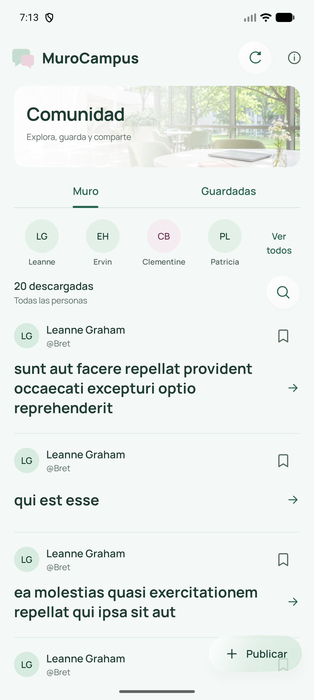
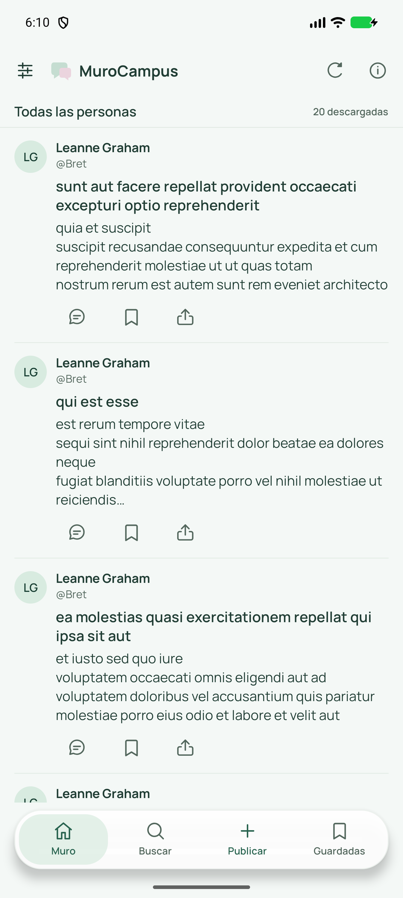
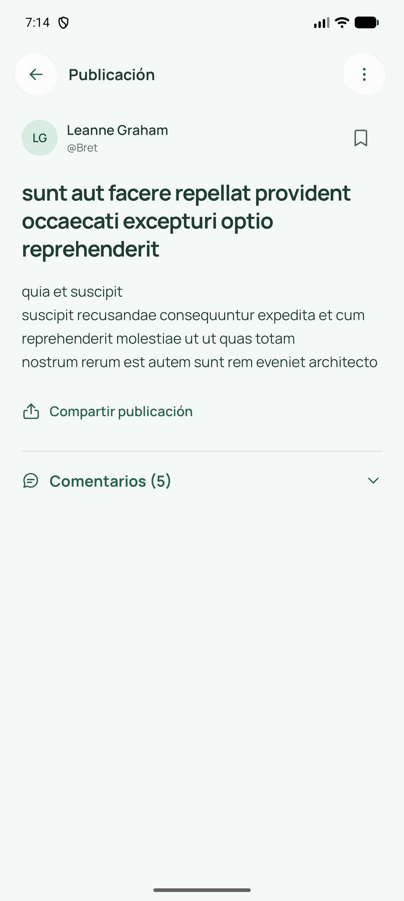
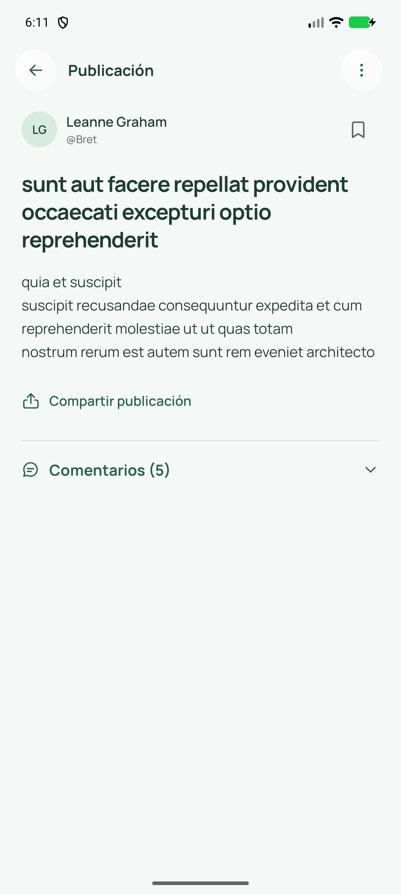
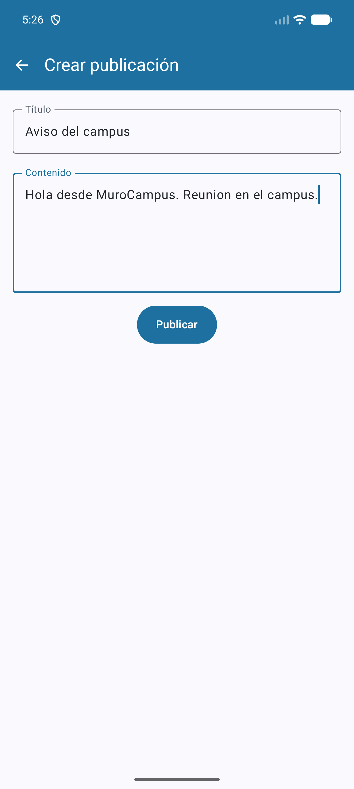
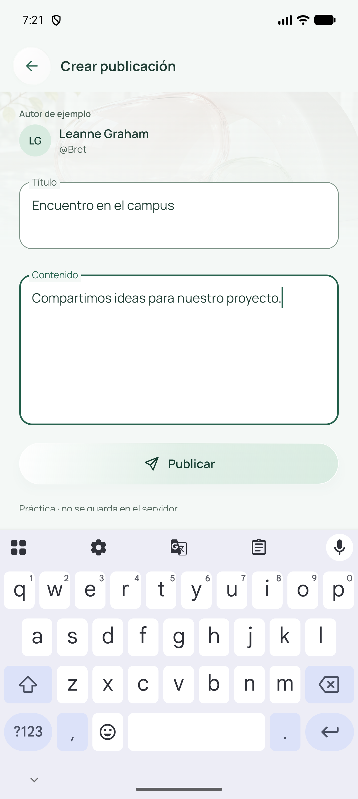
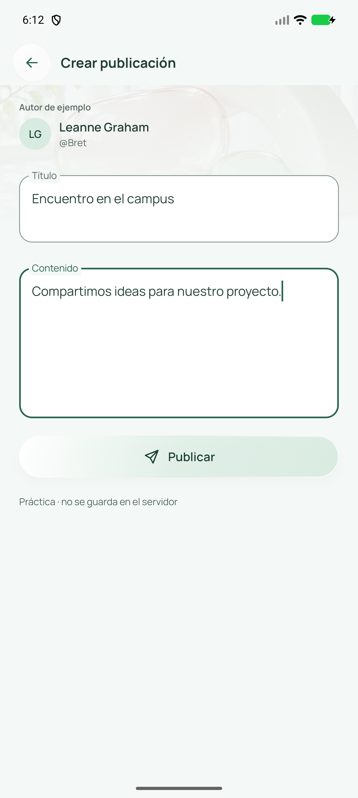
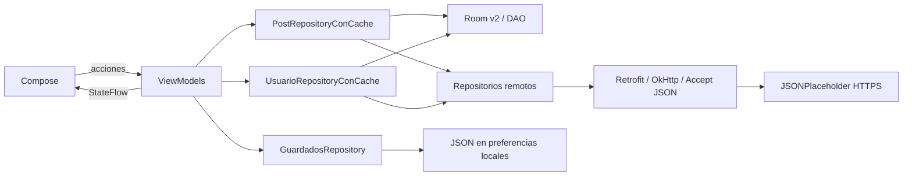

# MuroCampus

Daniella Leon · Laboratorio 09 · Fase 2

Un muro Android para consultar publicaciones, reconocer a sus autores, leer comentarios y guardar lecturas en el dispositivo. La fase 2 añade las seis mejoras de la guía. Su extensión social organiza el feed con autores de la API, cuerpo original, acciones en cada fila y navegación inferior; la lectura completa sigue en el detalle.

[Rama main · fase 1](https://github.com/Daniellaln/MuroCampusLeon/tree/main) · [Rama mejora-ia · fase 2](https://github.com/Daniellaln/MuroCampusLeon/tree/mejora-ia) · [Prompts](PROMPTS.md) · [Código para exponer](docs/GUIA_CODIGO_FASE2.md)

## Antes y después

<table>
<tr><th>Fase 1 · main</th><th>Fase 2 · nueve avances</th><th>Extensión social · avance 10</th></tr>
<tr><td></td><td></td><td></td></tr>
<tr><td></td><td></td><td></td></tr>
<tr><td></td><td></td><td></td></tr>
</table>

Son capturas reales del emulador de Windows. La comparación del muro muestra el ajuste de organización solicitado con referencias de X y Threads. [Galería actual · 19 estados](docs/GALERIA_SOCIAL.md) · [Historial de fase 2 · 29 estados](docs/GALERIA_FASE2.md).

## Qué cambió

Las seis mejoras del laboratorio están implementadas:

- Buscar por título en las publicaciones descargadas, combinado con filtro de persona y un conteo de resultados cuyo alcance se muestra.
- Editar título y contenido con PATCH, validar campos y mostrar la respuesta.
- Eliminar con confirmación, DELETE y comprobación del código HTTP.
- Enviar `Accept: application/json` mediante un interceptor común.
- Conservar en Room páginas exactas, detalles, comentarios y autores para las lecturas ya consultadas.
- Descargar páginas de veinte con Cargar más, reintento y fin de lista.

La organización actual parte de las capturas de X y Threads aportadas por Daniella: avatar de iniciales de 36 dp en un carril izquierdo; nombre, usuario, título original de hasta dos líneas y cuerpo de hasta cinco a la derecha. Cada fila ofrece comentarios, guardar y compartir con áreas de 48 dp. La cabecera es compacta y abre el filtro de personas; la navegación inferior reúne Muro, Buscar, Publicar y Guardadas. El detalle conserva título completo y cuerpo seleccionable sin portada ni Leer más. Un fallo de comentarios conserva la lectura y ofrece reintentar esa sección.

**Función propia desde fase 1:** Compartir publicación abre la hoja de Android con título, cuerpo y enlace.

**Función propia de fase 2:** Guardadas conserva snapshots completos en JSON local, independientes de la caché Room. Se pueden abrir sin red aunque la API no esté disponible. El marcador indica que el guardado pertenece al dispositivo; no hay cuenta ni sincronización remota.

## Abrir y recorrer

Abre esta carpeta en Android Studio con JDK 21 y SDK 37. La app compila contra SDK 37, apunta a SDK 36 y admite Android 7 o superior (`minSdk 24`); paquete `com.leon.murocampus`. No requiere Firebase, cuenta ni clave. La primera consulta necesita internet.

En Muro, abre el filtro de la cabecera y selecciona una persona; Todas las personas o el cierre junto al nombre quitan el filtro. Buscar, en la barra inferior, muestra el campo por título y su alcance. Toca la lectura para abrir el detalle o el icono de comentarios para entrar con esa sección desplegada. El marcador guarda una copia en Guardadas; compartir abre la hoja de Android. Muro y Guardadas conservan desplazamientos distintos. El menú del detalle contiene editar y eliminar. Publicar abre el editor e identifica al Autor de ejemplo; Atrás protege un borrador modificado y el éxito ofrece Volver al muro. La navegación inferior se oculta mientras el teclado está visible.

[JSONPlaceholder](https://jsonplaceholder.typicode.com/) entrega textos de relleno originales y usuarios de muestra. Crear, editar y eliminar **son simulados**: POST puede devolver id 101, PATCH devuelve el texto recibido y DELETE un código correcto, pero la recarga recupera los originales del servidor. La app muestra un recibo con salida clara y no incorpora esas escrituras a Room como si fueran persistencia remota. Guardadas sí es una escritura local real elegida por la persona.

La búsqueda usa solo lo descargado o lo guardado según la vista; Cargar más amplía únicamente el primer alcance. No se fabrican noticias, fotos de autores, fechas, reacciones ni categorías. Las imágenes generadas son ambientación, no datos asociados a cada publicación ni prueba de una ubicación real.

## Diseño y recursos

Blanco fresco, verde suave, rosa ligero y Manrope local. El vidrio inspirado combina degradados, borde de luz y respuesta al tacto; no usa una API de Apple ni promete refracción del fondo. Los recursos locales de campus y conversaciones tienen su procedencia registrada; el campus se conserva como exploración anterior y no aparece en la cabecera actual. Los 22 iconos propios se distribuyen en SVG y VectorDrawable; Manrope conserva licencia SIL OFL.

El tema sigue el modo claro u oscuro de Android. Los controles mantienen áreas táctiles mínimas de 48 dp, el texto usa sp y las animaciones se desactivan cuando Android indica escala cero. [Sistema de diseño](DESIGN.md) · [Procedencia](diseno/IMAGENES.json) · [Revisión final](docs/VEREDICTO_SOCIAL.md).

## Estructura y MVVM

```text
app/src/main/java/com/leon/murocampus/
  MainActivity.kt                    composición de repositorios y ViewModels
  model/                             Post, Usuario, Comentario y estados
  data/remote/                       Retrofit, PostApi, UsuarioApi y Accept
  data/local/MuroDatabase.kt          entidades, DAO, Room v2 y migración 1→2
  data/PostRepositoryConCache.kt      páginas, lectura y procedencia por recurso
  data/UsuarioRepositoryConCache.kt   usuarios y pertenencia del listado
  data/GuardadosRepository.kt         snapshots JSON persistentes del dispositivo
  viewmodel/                         estado, cancelación y SavedStateHandle
  ui/                                feed, detalle, formularios y controles
  ui/theme/Theme.kt                   colores y tipografía de ambos temas
```



La UI no llama a Retrofit ni abre Room. El ViewModel conoce contratos de repositorio y transforma `Result` en estado. La cancelación se relanza. Los autores cargan sin bloquear publicaciones; el detalle publica el post antes de esperar sus comentarios. `SavedStateHandle` restaura búsqueda y persona desde la primera página.

Room registra la pertenencia exacta de cada página, incluidos snapshots de cero comentarios. La migración 1→2 añade usuarios sin borrar publicaciones, comentarios ni páginas. Un fallo de conexión permite usar la copia; un error HTTP o JSON inválido sigue siendo error. Si llega una respuesta correcta y falla guardarla por SQLite, se conserva la lectura de red y se comunica el problema de caché.

## Para pensar

**¿GET, POST, Body y Query?** GET consulta; POST envía una creación. Body lleva el objeto JSON del nuevo post; Query añade userId a la URL del filtro.

**¿Por qué posts y no /posts?** La ruta relativa conserva el camino de la URL base. Una barra inicial vuelve a la raíz del servidor. En este host con base raíz pueden coincidir, pero no es correcto depender de esa casualidad.

**¿Por qué Result?** Permite devolver éxito o fallo con un contrato común. El ViewModel transforma ese resultado en estado visible sin conocer las excepciones de red. CancellationException se relanza para detener realmente el trabajo.

**¿Sin INTERNET o sin ignoreUnknownKeys?** Sin el permiso, la conexión falla aunque el dispositivo tenga red. Sin ignoreUnknownKeys, un campo adicional del servidor puede romper la conversión. Un campo obligatorio que no llegue sigue siendo un error.

**¿Por qué when sobre UiState?** Representa un estado coherente: cargando, éxito o error. Tres booleanos separados permitirían combinaciones contradictorias.

**¿Y con un servidor real?** La creación se guardaría en el backend. Después del éxito habría que recargar la lista o incorporar la respuesta del servidor y respetar su contrato de persistencia y autorización.

## Commits y comprobaciones

main conserva los 12 commits de fase 1. Los nueve primeros avances de fase 2 están publicados y mantienen sus capturas, verificaciones y copias acumulativas. La organización social se documenta como décimo avance; conserva las seis mejoras y las funciones propias. La evidencia de un estado no se atribuye a otro commit.

El cierre histórico de los nueve avances aprobó **75 pruebas: 47 unitarias y 28 en Android**, sin fallos ni omitidas; compilación y lint terminaron correctamente, con 19 advertencias y cero errores de lint. Sus XML y registros se conservan en [Verificación de fase 2](docs/VERIFICACION_FASE2.md). La extensión social aprueba **77 pruebas: 47 unitarias y 30 en Android**, sin fallos ni omitidas; compilación y lint terminan correctamente, con 19 advertencias y cero errores de lint. [Verificación actual y registros](docs/VERIFICACION_SOCIAL.md). El alcance disponible es un emulador Android API 37 sobre Windows; no se afirma prueba en teléfono físico ni en Mac. La prueba de Compartir abre la hoja de Android sin enviar mensajes a otras personas.

La implementación tuvo asistencia de Codex. PROMPTS.md contiene bloques para repetir el trabajo con Gemini; no inventa respuestas de una sesión de Gemini ni un porcentaje de similitud no medido.
