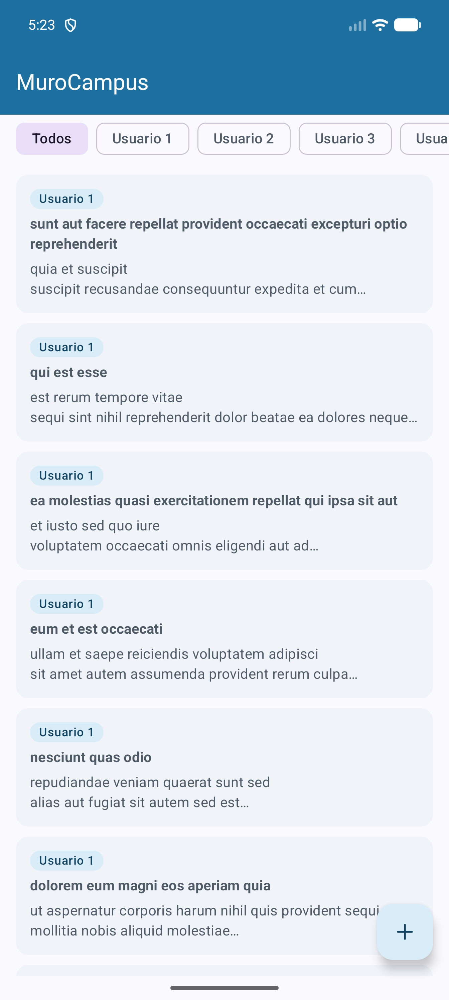
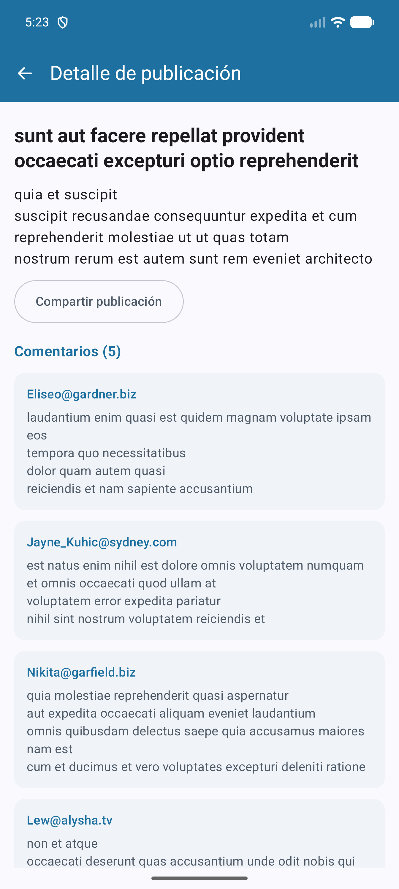
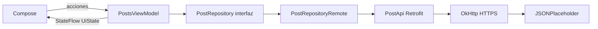

# MuroCampus

Daniella Leon · Laboratorio09 · Fase1

Muro de publicaciones de práctica: lista, detalle con comentarios, filtro por usuario y creación mediante un servicio REST. Kotlin, Compose Material3, Retrofit, OkHttp, kotlinx.serialization y MVVM con Repository.

[Repositorio público](https://github.com/Daniellaln/MuroCampusLeon) · [Código para exponer](docs/GUIA_CODIGO.md) · [Verificación](docs/VERIFICACION.md)

## Abrir y usar

Abre la raíz del proyecto en Android Studio. Usa JDK21 y SDK37. Paquete **com.leon.murocampus**, Android7 o superior. Gradle descarga las dependencias en la primera sincronización. No requiere Firebase, una cuenta ni una clave de API. La app sí necesita internet para consultar el servicio.

Al abrir carga100publicaciones. Toca una para ver el texto y sus5comentarios. Usa Todos o Usuario1–10 para filtrar; cada usuario tiene10publicaciones. El botón + abre el formulario: título y contenido son obligatorios. Al enviar, aparece Publicado con id101 y se limpian los campos; si falla, se conservan para reintentar. Atrás vuelve a la lista sin volver a descargarla.

**Función propia:** Compartir publicación abre el menú nativo de Android con título, contenido y enlace. Está en fase1 y debe conservarse en fase2. Las comprobaciones solo abrieron el menú; no enviaron mensajes a otras personas.

La API es [JSONPlaceholder](https://jsonplaceholder.typicode.com/). Sus datos son ficticios y los textos de relleno son normales. El POST devuelve201 e id101, pero **no guarda la publicación**: no aparecerá al recargar. No se finge persistencia local.

## Capturas

Lista y detalle:

 

Filtro por usuario y formulario:

 

Sin conexión y función propia:

 

Las demás capturas cubren éxito, recuperación de errores, horizontal y texto grande. Todas salen del emulador ejecutando esta versión.

## Estructura

```text
app/src/main/java/com/leon/murocampus/
  MainActivity.kt
  model/Modelos.kt, UiState.kt, DetalleUi.kt
  data/PostRepository.kt, UsuarioRepository.kt, Errores.kt
  data/remote/PostApi.kt, UsuarioApi.kt, RetrofitClient.kt
  viewmodel/PostsViewModel.kt, PostsViewModelFactory.kt, UsuarioViewModel.kt
  ui/Componentes.kt, MuroCampusApp.kt
  ui/PantallaLista.kt, PantallaDetalle.kt, PantallaCrear.kt
  ui/CompartirPublicacion.kt
  ui/theme/Theme.kt
```



La pantalla observa su ViewModel; el ViewModel solo conoce la interfaz del Repository. El Repository convierte los errores en Result y deja pasar la cancelación. El traductor de errores está en data/Errores.kt: el ViewModel no conoce Retrofit, PostApi, HttpException ni Context. MainActivity arma las dependencias. El ejemplo Usuario se conserva como cadena de modelo, API, Repository y ViewModel; no añade otra pantalla al alcance.

## Para pensar

**¿GET, POST, Body y Query?** GET consulta; POST envía una creación. Body lleva el objeto JSON del nuevo post; Query añade userId a la URL del filtro.

**¿Por qué posts y no /posts?** La ruta relativa conserva el camino de la URL base. Una barra inicial vuelve a la raíz del servidor. En este host con base raíz pueden coincidir, pero no es correcto depender de esa casualidad.

**¿Por qué Result?** Permite devolver éxito o fallo con un contrato común. El ViewModel transforma ese resultado en estado visible sin conocer las excepciones de red. CancellationException se relanza para detener realmente el trabajo.

**¿Sin INTERNET o sin ignoreUnknownKeys?** Sin el permiso, la conexión falla aunque el dispositivo tenga red. Sin ignoreUnknownKeys, un campo adicional del servidor puede romper la conversión. Un campo obligatorio que no llegue sigue siendo un error.

**¿Por qué when sobre UiState?** Representa un estado coherente: cargando, éxito o error. Tres booleanos separados permitirían combinaciones contradictorias.

**¿Y con un servidor real?** La creación se guardaría en el backend. Después del éxito habría que recargar la lista o incorporar la respuesta del servidor y respetar su contrato de persistencia y autorización.

## Commits y alcance

main tiene los11pasos de la guía más el commit propio de compartir:12avances. Se respetan los mensajes que el documento exige; cada paso se compiló antes de publicar. Los snapshots completos por commit se entregan aparte. El rediseño, las imágenes y las mejoras de la fase2 quedan pendientes de esa fase.

No se recibió un proyecto base ejecutable adjunto. La base se reconstruyó con los contratos y mockups de GLAB-S09-JLEONS-2026.docx, conservando nombres de clases y funciones; el paquete usa com.leon por preferencia de Daniella. Esta implementación contó con asistencia de Codex; no se declara trabajo realizado sin IA ni una sesión de Gemini inexistente.

## Pruebas

18unitarias y8instrumentadas aprobadas, incluyendo una prueba contra la API real. Compilación y lint sin errores. Se comprobaron100posts,10por cada usuario,5comentarios,404,POST201/id101 y cancelación, además de los recorridos sin internet y reintento. [Evidencia y límites](docs/VERIFICACION.md).
