# Capturas de fase1

Capturas directas del emulador.

## Lista

## Detalle y comentarios

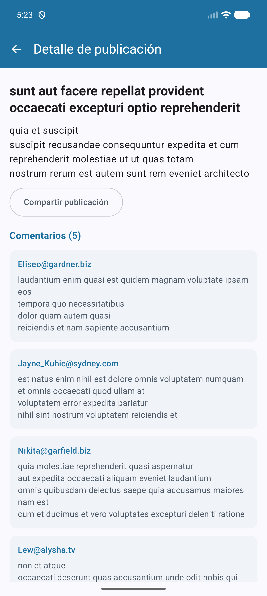

## Filtro usuario2

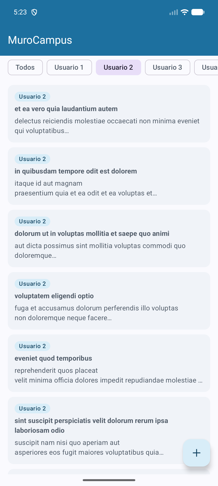

## Crear publicación

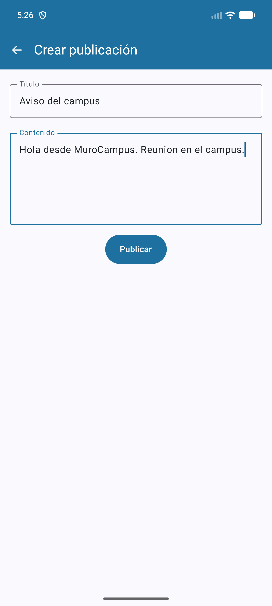

## Sin conexión

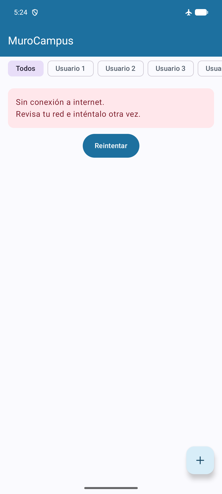

## Compartir

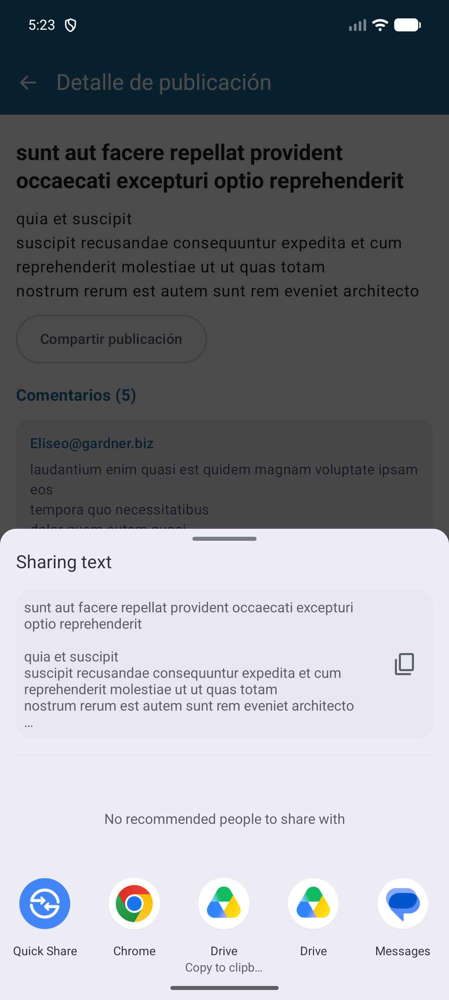

## Formulario vacío

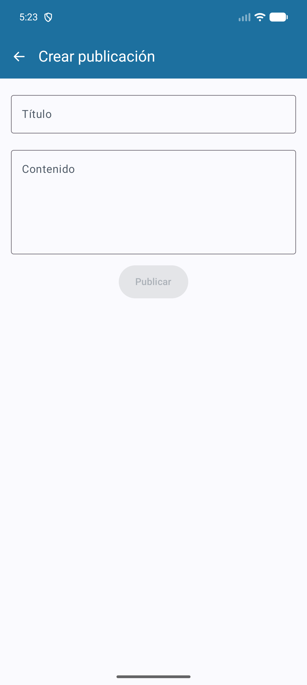

## Creación101

## Reintento de lista

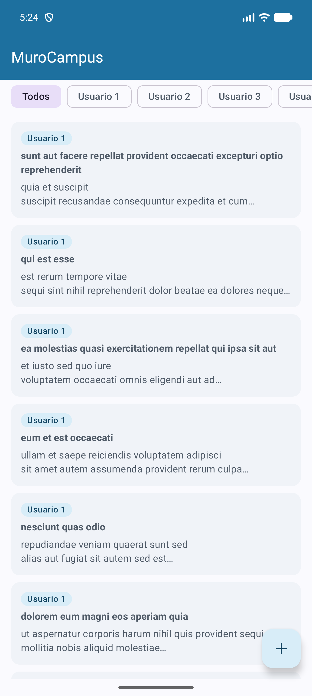

## Error de detalle

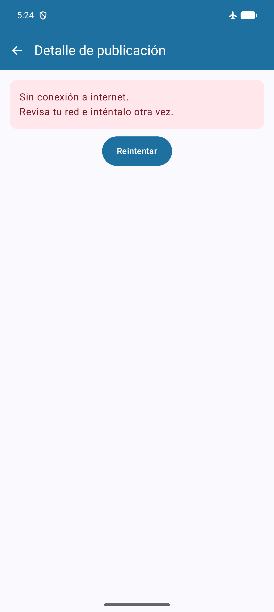

## Error al publicar conserva texto

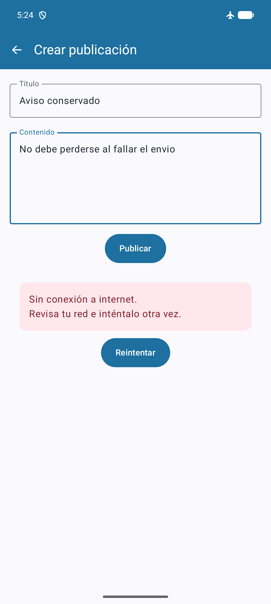

## Reintento de creación

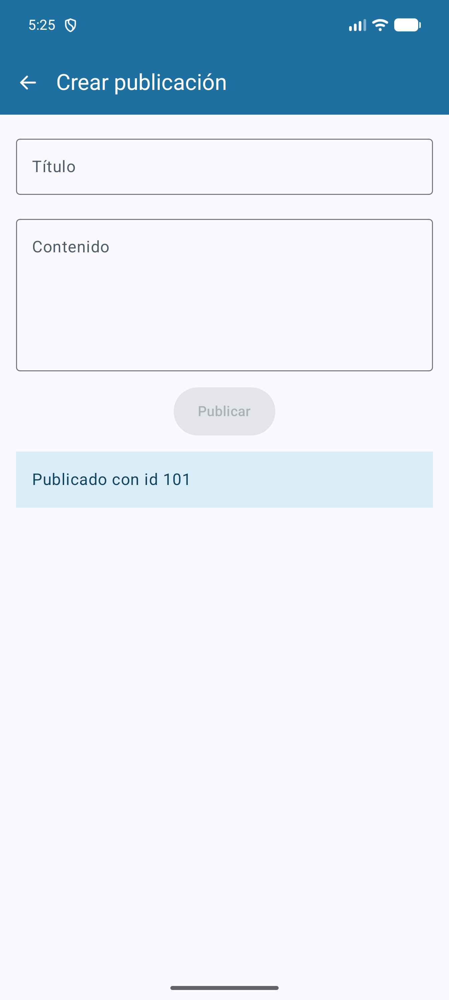

## Horizontal

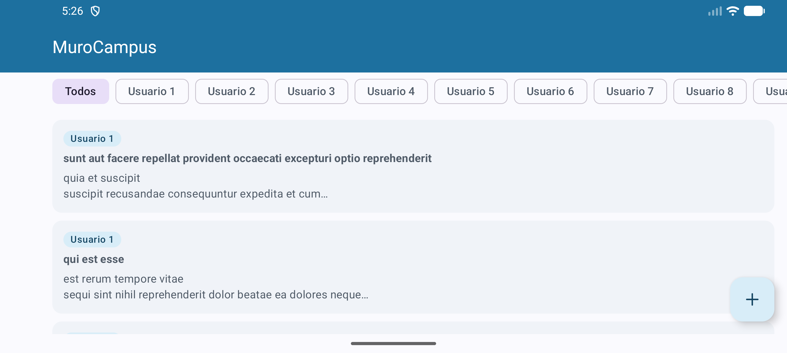

## Texto grande

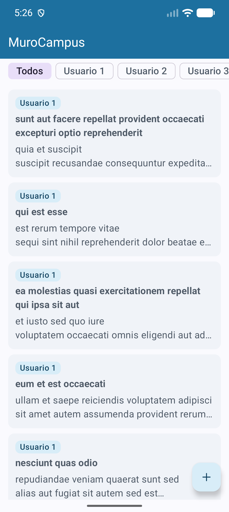
